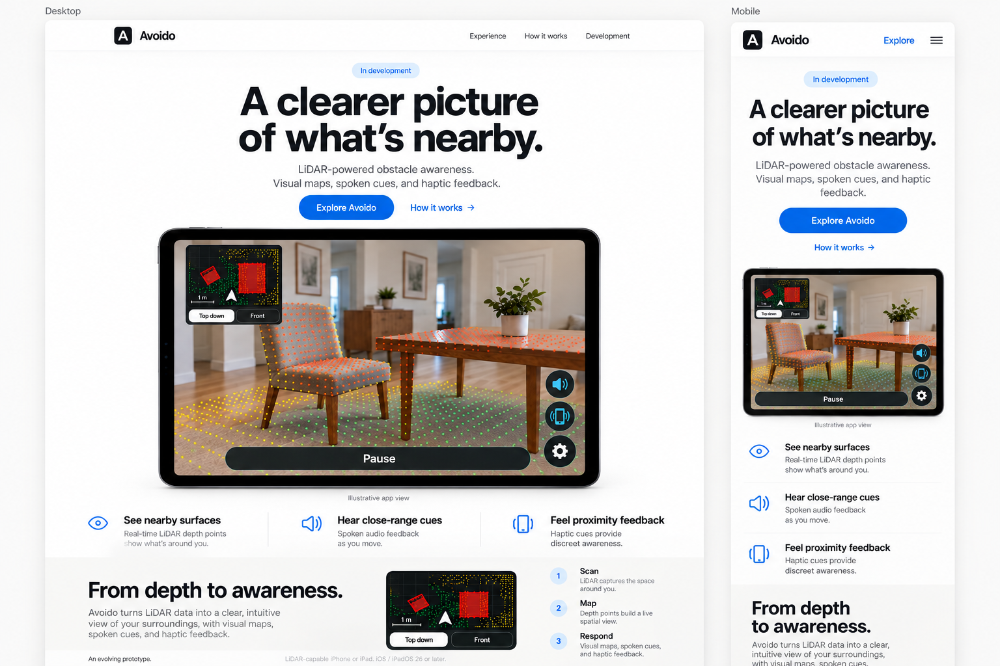

# Avoido website specification

Updated: 2026-10-11. Status: local website implemented and build-checked. Initial browser verification recorded; remaining acceptance checks and deployment pending.

## Project brief

Create a dedicated landing page that introduces Avoido, the native LiDAR obstacle-awareness app. Visitors can explore app illustrations, understand its visual maps and close-range feedback, and read its development status. The page is for people curious about the app; its primary action is exploring the project.

Keep the website in this subfolder, separate from the Swift app. Use Next.js 16.4 and prepare for later hosting on Vercel with a `vercel.app` address. The website does not perform sensing.

## Selected visual reference

The user selected this first mockup after reviewing a more spacious revision. This image is the primary visual reference. The later, more spacious mockup is superseded.

Retain the oversized centered headline, dominant landscape device image, compact feature row, and pale explanatory section. The reference is a generated concept, including the pictured app scene and sensor overlays; it is not a screenshot of measured app behavior. Render website text and controls as HTML rather than embedding this entire board as the page.

## Approved choices

- A dedicated Avoido product page, rather than a personal portfolio or engineering case study.
- Project exploration as the primary goal, with no signup backend.
- A light, calm Apple-inspired appearance, using the attached first design's proportions and density.
- A switchable Top down / Front app showcase.
- Subtle motion with reduced-motion support.
- A separate website subfolder, Next.js 16.4, and later Vercel hosting.
- Documentation was completed first. The user authorized local implementation with "lets roll" on 2026-10-11. Publication remains deferred.

## Agreed implementation plan

Build one page with hero, experience, how-it-works, and development sections. Desktop navigation links to those sections. Mobile navigation includes Explore and a working hamburger menu. Place the interactive map selector in the explanatory section to preserve the selected hero layout.

Use TypeScript, App Router, npm, and CSS Modules. Build the page as prerendered content, with small client enhancements for the menu and reveal behavior. Native radio state and CSS switch the map diagrams and captions, including without hydration. Include metadata, the existing app icon, and a social preview. These details are implemented locally; [verification.md](verification.md) records evidence and limitations.

## Boundaries

This specification covers the website only. Native app requirements and historical device reports remain authoritative for app behavior and validation.

Do not add browser camera or LiDAR access, accounts, forms, analytics, pricing, download badges, or public APIs. Do not change native app behavior or install anything on an iPad or iPhone. Publication is a later step.

Describe current capabilities without presenting pending physical validation, object recognition, collision prediction, or safe navigation as established results. Qualify haptics by device support. Website accessibility checks do not establish native app accessibility acceptance.

## Document guide

- [Requirements and acceptance criteria](requirements.md): stable website requirement IDs.
- [Visual and technical design](design.md): layout, copy, states, and proposed implementation values.
- [Implementation and remaining verification tasks](tasks.md): ordered checklist linked to requirements.
- [Local setup and later Vercel deployment](README.md): commands and hosting prerequisites.
- [Verification evidence](verification.md): executed checks and remaining limits.
- [Native app requirements](../docs/requirements.md): source of truth for app capability and operating boundaries.

Exact spacing, timing, and layout thresholds in the design are proposed implementation defaults. The selected visual direction and requested capabilities are explicit user choices. Record changes to these documents together so requirements, design, and tasks remain consistent.
